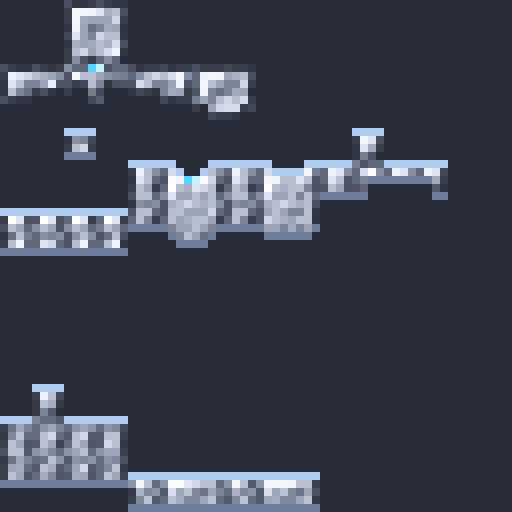
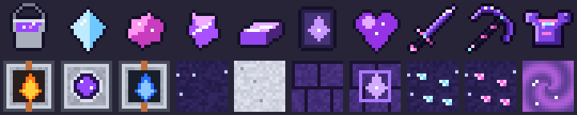

# Diamond Altar (mod Fabric 1.21.11)

Un **Autel d'Infusion** (blanc, 4 piliers à bobines dorées) qui transforme ton équipement
en diamant en armes légendaires, avec une animation : l'objet flotte, tourne de plus en plus
vite, des arcs électriques partent des piliers, puis un éclair le frappe.

## Textures des objets infusés

Chaque objet infusé a sa propre texture animée (reflet de diamant qui passe + gemme violette qui pulse) :


## Manuel en jeu

Chaque joueur reçoit le **Manuel Diamond Altar** en rejoignant le monde (sinon : un livre + un diamant
sur la table de craft, ou l'onglet créatif). Clic droit pour l'ouvrir : sommaire, touches, toutes les
capacités, l'armure, la Dimension Astrale, les mobs, le Gardien et tous les crafts avec les vrais objets.

## Craft de l'autel

```
[ vide ]              [Cœur Céleste]        [ vide ]
[ vide ]              [Étoile du Nether]    [ vide ]
[Lingot de netherite] [Lingot de netherite] [Lingot de netherite]
```

## Utilisation

1. Pose l'autel.
2. Clic droit avec un objet en diamant (casque, plastron, jambières, bottes, épée, pioche,
   hache, pelle, houe) ou une **masse**, ou une **lance en diamant** → l'objet est posé et l'infusion démarre (5 s).
3. Quand l'éclair tombe, clic droit pour récupérer ton objet **Infusé** (brillant, nom en cyan).
4. Avec un objet infusé en main : appuie sur **K** pour changer de capacité (touche modifiable
   dans Options → Commandes). L'épée se lance au **clic gauche**, les autres objets au **clic droit**.

## Capacités

| Objet | Capacités (touche K pour changer) |
|---|---|
| Épée (clic gauche) | **Tranche de la Volonté** (slash géant de 10 blocs, 30 dégâts, sans recharge) · **Lames Fantômes** (5 lames qui transpercent sur 24 blocs) · **Pas de l'Ombre** (téléportation de 10 blocs qui tranche) · **Jugement Céleste** (pilier de lumière du ciel, 40 dégâts) · **Faille du Néant** (trou noir qui aspire puis implose) |
| Pioche | **Foreuse de Diamant** (tunnel 3x3) · **Sphère de Cristal** (sphère de 5 blocs minée) · **Vision des Minerais** (les minerais brillent 10 s) · **Éruption de Cristaux** (pics de cristal sur 16 blocs) |
| Hache | **Cyclone d'Acier** · **Hache Boomerang** (part et revient) · **Bûcheron Titanesque** (abat l'arbre entier) · **Fissure** (fend le sol sur 14 blocs) |
| Pelle | **Onde Sismique** · **Sables Mouvants** (piège les ennemis 5 s) · **Excavation** (creuse 5x5x3) |
| Houe | **Moisson des Âmes** · **Lianes Étrangleuses** (immobilise les ennemis 4 s) · **Floraison** (soigne et fait pousser) |
| Masse | **Chute Météore** · **Puits de Gravité** (soulève puis écrase) · **Colère du Tonnerre** (foudre sur 10 monstres) |
| Casque | Vision nocturne + respiration aquatique + force des conduits |
| Plastron | Résistance II + résistance au feu |
| Jambières | Vitesse II + célérité II |
| Bottes | Saut II + grâce du dauphin + aucun dégât de chute |
| Armure complète | Régénération II + Force II + saturation + aura de lumière |
| Armure (plastron, **Shift + clic droit** pour lancer, **J** pour changer) | **Bouclier de Cristal** · **Ruée de Diamant** · **Nova Prismatique** · **Ailes de Diamant** · **Avatar de Diamant** · **Saut Astral** |
| Lance (clic gauche) | **Lance Comète** · **Charge Stellaire** · **Constellation** · **Tourbillon Galactique** · **Lance Polaire** |
| Encore plus | Épée : **Tranchant Céleste**, **Lames du Zodiaque** · Pioche : **Météorite Minière** · Hache : **Hache du Titan Stellaire** · Pelle : **Mur d'Astéroïdes** · Houe : **Tempête de Pétales** · Masse : **Pulsar** · Armure : **Bouclier Gravitationnel** |
| Nouveautés lunaires | Épée : **Croissant Lunaire**, **Pluie d'Étoiles**, **Éclipse** · Pioche : **Rayon Stellaire**, **Géode Céleste** · Hache : **Orbite Lunaire** · Pelle : **Gravité Lunaire**, **Cratère Lunaire** · Houe : **Faux Céleste**, **Jardin d'Étoiles** · Masse : **Supernova** |

Tous les objets infusés sont **incassables**. La **pioche, la hache et la pelle infusées** minent beaucoup plus vite, et la **hache infusée abat tout
l'arbre** quand tu casses une bûche (accroupi pour couper normalement).

L'armure infusée est incassable et très solide : armure 6/12/9/6, robustesse +5 et +6 PV par pièce,
résistance au recul.

Quand tu portes l'armure infusée, elle a sa propre texture de diamant infusé (liserés dorés,
gemmes violettes) :



## Dimension Astrale

1. **Fusionneur** (craft : un **diamant** au milieu de la table de craft et **3 blocs de fer** en
   bas). Côté **gauche** (dessin de lave) : lave,
   côté **droit** (dessin d'eau) : eau. Clic droit avec les seaux, ou pose de la lave / de l'eau
   juste à côté : les **tuyaux** l'aspirent. Quand les deux sont pleins, ça bout, ça tourne et ça
   se mélange en **Essence Galactique** violette (clic droit avec un seau vide pour la récupérer).
2. **Portail Astral** : un cadre de **blocs de diamant** comme un portail du Nether (4×5 minimum),
   puis clic droit dedans avec le **Seau d'Essence Galactique** (comme un briquet).
3. **La dimension** : des îles flottantes dans un ciel violet étoilé (Plaines Lunaires, Champs de
   Cristal), avec du **Minerai de Lunarite** et du rare **Minerai d'Astralite** (le minerai ultime).
4. **Bastions Astraux** (pyramides de blackstone à gradins, lac de lave et 3 coffres au sommet) et **Châteaux Astraux** (plus rares) où l'**Autel du Gardien**
   invoque le boss : le **Gardien Astral** (200 PV, hache, **saut écrasant** qui l'étourdit : dégâts x2 pendant 4 s, pluie d'étoiles, ondes de choc,
   téléportation). Il lâche le **Cœur du Gardien**, un Lingot d'Astralite et parfois
   le **Gabarit d'Amélioration Astrale** (aussi très rare dans les coffres).
5. **Astralite** : cuire l'Astralite Brute → **Fragment d'Astralite**. 6 fragments + 2 lingots de
   netherite, n'importe où sur la table de craft → **Lingot d'Astralite**.
6. **Cœur Céleste** : à la table de forge, Gabarit d'Amélioration Astrale + **Cœur du Gardien** +
   Lingot d'Astralite → **Cœur Céleste**. Il se met **en haut au milieu** du craft de l'Autel
   d'Infusion : il faut donc aller dans la dimension pour fabriquer l'autel.



Tout est aussi dans l'onglet créatif **Diamond Altar** (avec l'équipement déjà infusé).

## Les 7 Royaumes

Sept nouvelles dimensions (îles flottantes), à visiter dans l'ordre. Chacune a sa pierre, son sol, son décor,
son **minerai**, son **boss unique** et son **armure légendaire**.

| Royaume | Minerai | Boss | Bonus de l'armure complète |
|---|---|---|---|
| **Braise** (basalte, magma) | Pyronite | **Seigneur des Braises** (blaze géant, 300 PV) : anneaux de flammes | Résistance au feu, Force, immunité au feu |
| **Givre** (neige, pics de glace) | Cryonite | **Reine du Givre** (vagabonde à l'arc, 350 PV) : blizzard | Vitesse II, Résistance, immunité au gel |
| **Tempêtes** (orage, pylônes) | Fulgurite | **Titan de la Tempête** (breeze colossal, 400 PV) : foudre | Vitesse III, Saut III, Célérité II, pas de chute ni de foudre |
| **Sylvestre** (grands arbres) | Verdite | **Béhémoth Sylvestre** (ravageur, 450 PV) : racines, soin | Régénération II, saturation, immunité au poison |
| **Abysses** (sable bleu, coraux) | Abyssite | **Léviathan des Abysses** (noyé au trident, 500 PV) : raz-de-marée | Respiration, Grâce du dauphin, Force des conduits, Force II |
| **Ombres** (ténèbres, obsidienne) | Umbrite | **Roi des Ombres** (squelette wither, 550 PV) : ténèbres, téléportation, Ombres | Vision nocturne, Force II, invisible accroupi |
| **Soleil** (sable doré, obélisques) | Solarite | **Paladin Solaire** (vindicateur, 600 PV) : colonnes de lumière, soin | Résistance II, Régénération, Force II, Absorption IV |

1. **Cadre des Royaumes** : 8 obsidiennes autour d'un **Lingot d'Astralite** → 8 cadres. Construis un cadre comme un
   portail du Nether (4×5) et fais clic droit dedans avec la **Clé** du royaume (elle n'est pas consommée).
2. **Clés** : 2 lingots du royaume précédent (Astralite pour la 1re) + 2 objets du thème + un œil de l'Ender
   (poudre de blaze, glace bleue, paratonnerre, mousse, cristaux de prismarine, éclat d'écho, poudre lumineuse).
3. **Minerais** : le minerai brut se cuit en lingot (four ou haut fourneau). Pioche en fer pour les 3 premiers, en diamant ensuite.
4. **Boss** : le **Sceau** du royaume (4 lingots + un diamant), clic droit dans son royaume → rituel de 3 s → le boss
   apparaît. Barrage tombant du ciel, onde de choc et attaque signature ; il enrage sous 40 % de PV.
   Il lâche l'**Éclat** de son royaume, des lingots et du minerai brut.
5. **Armures légendaires** : forme de craft habituelle avec les lingots, incassables, de plus en plus solides
   (jusqu'à +8 PV et 15 d'armure par pièce pour le Soleil).
6. **Épée des Sept Royaumes** : les **7 éclats** autour d'une **épée en netherite**, une **étoile du Nether** en bas
   au milieu. 30 dégâts, incassable ; chaque coup brûle, gèle, empoisonne, flétrit et parfois foudroie.
   **Clic droit** : *Jugement des Sept Royaumes*, sept colonnes de lumière qui explosent autour de toi (recharge 8 s).

### Récompenses : plus le boss est fort, plus le butin l'est

| Boss | Équipement en diamant | Netherite | Aetherite | Équipement en Aetherite | Spécial |
|---|---|---|---|---|---|
| Braise, Givre | 1 pièce, parfois | – | – | – | |
| Tempêtes | 1 pièce, souvent | oui | – | 2 % | |
| Sylvestre | 1 pièce sûre | oui | – | 4 % | |
| Abysses | 2 pièces | oui | 1 lingot (1 fois sur 2) | 7 % | |
| Ombres | 4 pièces | oui | 1 à 2 lingots | 12 % | **Perle des Royaumes** |
| **Soleil** | **tout l'équipement** (épée, pioche, hache, armure) | oui | **2 à 4 lingots** | 20 % | **Ailes de l'Aurore** |

Les pièces en diamant sont parfois déjà **infusées**. Chaque boss lâche aussi son Éclat, des lingots et des diamants.

- **Aetherite** : le métal le plus rare. Armure (6/16/12/6, robustesse 7, +10 PV par pièce), **Épée** (22 dégâts) et
  **Pioche** (mine tout, très vite), toutes incassables, aussi fabricables avec des lingots d'Aetherite. Armure complète :
  Force III, Résistance II, Vitesse II, Régénération II, vision nocturne ; immunité au feu, aux chutes, au gel, à la foudre et à la noyade.
- **Ailes de l'Aurore** (moyen de transport) : des élytres incassables qui se **propulsent toutes seules** dans la
  direction du regard (accroupi : planer sans propulsion).
- **Perle des Royaumes** (moyen de transport) : **accroupi + clic droit** pour choisir le monde (Overworld, Astral ou un
  des 7 Royaumes), **clic droit** pour s'y téléporter (recharge 20 s).

Les textures et toutes les données des royaumes sont générées par `python3 tools/realms_gen.py`
(puis `python3 mc26/tools/convert_data.py` pour la version 26.3).

## Version plugin (serveur Paper)

Un 2ᵉ téléchargement, **`diamond-altar-plugin`**, contient un plugin pour serveur **Paper 1.21.11**
et son **pack de ressources** : les joueurs n'ont pas besoin du mod. Voir `plugin/LISEZMOI.txt`.
Commandes : clic gauche (épée/lance), clic droit (outils), **F** pour changer de capacité,
**accroupi + clic droit** pour l'armure, **accroupi + F** pour changer la capacité d'armure.

## Compiler

Il faut Java 25 pour compiler (le mod tourne avec Java 21+) :

```
./gradlew build
```

Le `.jar` est dans `build/libs/`. Mets-le dans `.minecraft/mods` avec **Fabric Loader** et
**Fabric API** pour Minecraft 1.21.11.

Chaque push sur GitHub compile aussi le mod automatiquement (onglet **Actions** → dernier
build → artefact `diamond-altar-mod`).
